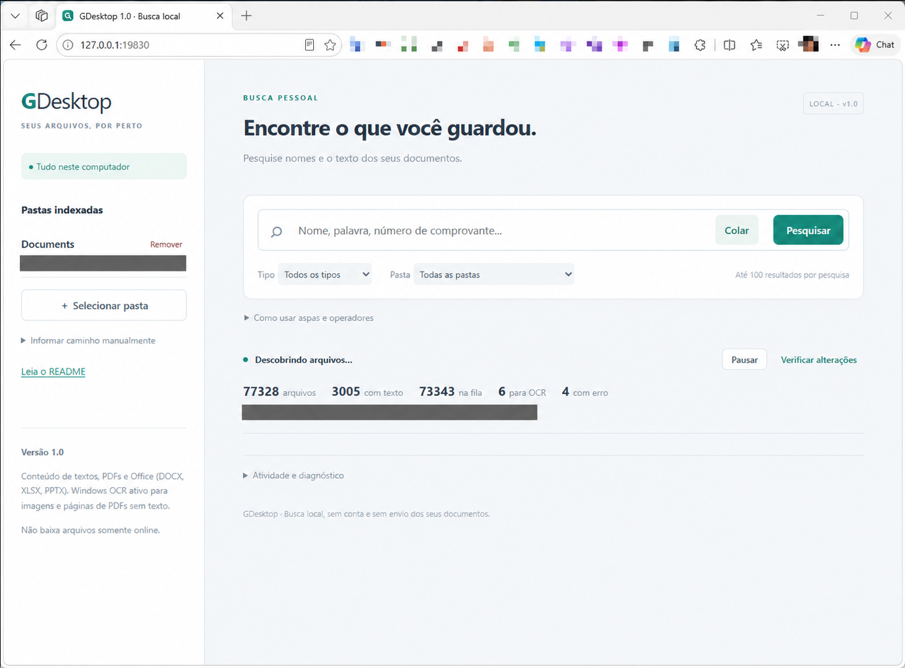

# GDesktop 1.0

Aplicativo local de busca de arquivos para Windows, inspirado no Google Desktop. Projeto independente, sem vínculo com o Google. C#/.NET 10, pesquisa no navegador e aplicativo na bandeja. Documentos, consultas e conteúdo do índice permanecem neste computador.

**Versão atual: 1.0.0.** Busca funcional em texto/PDF e Office moderno (DOCX, XLSX, PPTX), atualização do índice, gerenciamento de pastas e consolidação de pastas pai. Proteção OneDrive testada em pasta pequena, incluindo transições entre nuvem e local. Windows OCR integrado; IA permanece como próxima etapa. As limitações de cobertura e escala continuam descritas abaixo; veja também `CHANGELOG.md`.

## Interface



Captura da aplicação em uso, com os caminhos pessoais ocultados.

## Instalar em outro computador com o instalador pronto

[**Baixar o instalador para Windows x64**](https://github.com/eduardoellery/GDesktop-Public/releases/latest) — abra **Assets** e escolha o arquivo `.exe`.

O arquivo para levar à outra máquina é **`GDesktop-Setup-1.0.0-win-x64.exe`**, gerado em `artifacts\installer`. Copie esse único arquivo por pendrive ou outro meio e execute-o no Windows x64 de destino.

1. Abra o instalador e siga as telas em português. A instalação é para o usuário atual, por padrão em `%LOCALAPPDATA%\Programs\GDesktop`, sem exigir administrador.
2. Escolha se deseja um atalho na área de trabalho. Um atalho também fica no menu Iniciar.
3. Ao concluir, marque **Abrir GDesktop**, selecione suas pastas e aguarde a indexação.

O instalador inclui o runtime .NET e todos os arquivos necessários do aplicativo. **Não precisa baixar o repositório, compilar, instalar SDK .NET, Office, Node.js ou Tesseract na máquina de destino.** A instalação e a busca podem funcionar sem internet; instalar um idioma OCR ausente é uma etapa separada do Windows e pode exigir conexão e administrador. Consulte a seção de OCR abaixo.

**Validação em outro computador:** o usuário confirmou que testou o instalador em outro Windows limpo e que funcionou corretamente.

O instalador ainda **não possui assinatura digital própria**, portanto o Windows pode exibir um aviso de editor desconhecido/SmartScreen. Confira a origem do arquivo antes de executá-lo. Não há inicialização automática com o Windows.

Para atualizar, saia do GDesktop pelo ícone da bandeja e execute o novo instalador. Para remover, use **Aplicativos instalados** nas configurações do Windows ou **Desinstalar GDesktop** no menu Iniciar. Atualizações e desinstalações preservam o índice em `%LOCALAPPDATA%\GDesktop`; ele é criado pela aplicação, não acompanha o pacote e contém dados pessoais. O instalador nunca inclui o índice ou documentos da máquina onde foi gerado.

### Gerar um novo instalador a partir do código

Na máquina de desenvolvimento, prepare o SDK com `Preparar.ps1`, instale [Inno Setup 6.7.4 ou superior](https://jrsoftware.org/isdl.php) e execute:

```powershell
powershell -NoProfile -ExecutionPolicy Bypass -File .\Criar-Instalador.ps1
```

Se necessário, informe `-IsccPath "C:\caminho\ISCC.exe"`. O script publica em `artifacts\installer-app`, compila `installer\GDesktop.iss` e grava o instalador e um arquivo SHA-256 em `artifacts\installer`. A versão vem de `src\GDesktop\GDesktop.csproj`. Binários do compilador e pacotes gerados não são enviados ao Git.

## Começar em outro computador após baixar o repositório

O ZIP do GitHub contém **código-fonte**, não o aplicativo pronto nem o instalador gerado. Se recebeu o instalador, use a seção anterior. Se baixou apenas o código, siga as etapas abaixo para preparar o SDK e compilar uma vez nesse computador.

### 1. Conferir os requisitos e extrair os arquivos

- Use um computador **Windows x64**. A publicação atual é `win-x64`; não há pacote para Linux, macOS ou Windows ARM64. A aplicação usa APIs de Windows a partir da versão 10.0.19041; outras versões do sistema ainda precisam de validação específica.
- Tenha um navegador, como o Microsoft Edge, e o **Windows PowerShell** (`powershell.exe`).
- Tenha acesso à internet para baixar o SDK .NET e as dependências durante a preparação/compilação. Depois, a busca e o OCR funcionam localmente, sem conexão.
- Não precisa instalar Visual Studio, Microsoft Office, SQL Server, Node.js ou Tesseract para compilar e usar a aplicação. Node.js é necessário somente para executar os testes opcionais.

No GitHub, abra este repositório público e use **Code → Download ZIP**. Extraia **todo o ZIP** para uma pasta local em que seu usuário possa gravar, por exemplo `C:\Aplicativos\GDesktop`. Não execute os scripts dentro do ZIP. Mantenha as subpastas e os arquivos na mesma estrutura do repositório.

Nos exemplos abaixo, substitua `C:\Aplicativos\GDesktop` pela pasta que contém `README.md`, `Preparar.ps1`, `Compilar.ps1` e `Iniciar.cmd`. Ao extrair o ZIP, ela pode se chamar `GDesktop-Public-main`.

### 2. Preparar o SDK e compilar

Abra o PowerShell normalmente, **sem precisar executar como administrador**, e rode os comandos abaixo, um de cada vez. Só avance se o comando anterior terminar sem erro:

```powershell
cd "C:\Aplicativos\GDesktop"
powershell -NoProfile -ExecutionPolicy Bypass -File .\Preparar.ps1
powershell -NoProfile -ExecutionPolicy Bypass -File .\Compilar.ps1
```

`Preparar.ps1` baixa o SDK .NET **10.0.403** para `.dotnet` dentro do projeto; não exige uma instalação global. `Compilar.ps1` restaura os pacotes NuGet e gera o aplicativo completo em `artifacts\GDesktop`. A primeira execução pode levar alguns minutos, conforme a conexão e o computador. O parâmetro `ExecutionPolicy Bypass` vale para o processo iniciado pelo comando; não altera permanentemente a política do Windows.

Ao terminar, deve aparecer **Pronto: artifacts/GDesktop/GDesktop.exe**. Confirme que a pasta contém `GDesktop.exe`, `GDesktop.Extractor.exe`, `README.md`, as bibliotecas e a subpasta `wwwroot`.

### 3. Abrir e fazer a primeira pesquisa

Dê dois cliques em `Iniciar.cmd` na raiz do projeto, ou execute:

```powershell
.\Iniciar.cmd
```

A aplicação abre a pesquisa no navegador e fica com um ícone na bandeja, perto do relógio. Se a aba for fechada, reabra a pesquisa pelo ícone da bandeja. Não precisa configurar servidor, porta ou serviço do Windows.

Clique em **Selecionar pasta**, escolha inicialmente uma pasta pequena com arquivos locais e acompanhe a indexação. Pesquise uma palavra conhecida de um TXT, PDF com texto ou DOCX dessa pasta. O índice deste computador começa vazio: as pastas e o banco pessoal do computador anterior não acompanham o repositório. Os dados novos ficam em `%LOCALAPPDATA%\GDesktop`.

### 4. Habilitar o idioma do Windows OCR, se necessário

O reconhecimento de imagens e PDFs digitalizados depende de um **idioma OCR instalado no próprio Windows**. O aplicativo tenta português do Brasil (`pt-BR`) primeiro e, em seguida, os idiomas disponíveis no perfil do usuário. O SDK .NET não instala esses idiomas.

Se o OCR informar que não existe idioma disponível, instale o recurso de reconhecimento de texto/OCR do Windows para o idioma desejado. Para instalar português do Brasil, uma opção é abrir o **Windows PowerShell como administrador** e executar:

```powershell
Add-WindowsCapability -Online -Name "Language.OCR~~~pt-BR~0.0.1.0"
```

Essa instalação usa o Windows Update e pode depender das permissões ou políticas da empresa. Depois de concluir, feche o GDesktop pela opção **Sair** da bandeja, abra novamente e clique em **Tentar novamente arquivos com erro**, na seção **Atividade e diagnóstico**. Sem o idioma OCR, a busca por nomes e a extração de texto digital continuam disponíveis.

Para conferir o OCR, adicione uma imagem nítida ou um PDF digitalizado com texto legível, aguarde o processamento e pesquise uma palavra presente na imagem. A qualidade do reconhecimento pode variar.

### Alternativa: copiar uma compilação já pronta

Se outro computador já compilou o projeto, copie a **pasta inteira `artifacts\GDesktop`** para o novo Windows x64 e abra `GDesktop.exe` dentro dela. Nesse caso não precisa executar `Preparar.ps1` ou `Compilar.ps1`, nem instalar o SDK/runtime .NET separadamente: a publicação é autocontida. O idioma OCR do Windows continua necessário para reconhecer imagens. Copiar somente o executável não é suficiente.

### Se algo não funcionar

- **“Execute Compilar.ps1 antes de iniciar”**: o ZIP não inclui os executáveis; conclua os passos de preparação e compilação.
- **`.dotnet\dotnet.exe` ausente**: execute `Preparar.ps1` na pasta correta e confira se o download terminou.
- **Erro ao baixar o SDK ou restaurar pacotes**: confira internet, proxy e acesso às fontes Microsoft/NuGet. Em uma rede corporativa, pode ser necessário pedir liberação ao responsável.
- **Arquivo baixado bloqueado pelo Windows**: confira a origem. Se confiar no arquivo, use **Propriedades → Desbloquear**, quando essa opção estiver disponível, antes de extrair/executar. Políticas corporativas podem impedir a execução de scripts.
- **Aplicativo já está em execução**: procure o ícone da bandeja para abrir a pesquisa ou encerrar a instância existente.
- **Conteúdo de arquivo OneDrive não aparece**: se ele estiver somente online, apenas nome e metadados serão indexados. Disponibilize localmente apenas os arquivos desejados pelo próprio OneDrive e aguarde a atualização.
- **Falha de OCR**: confira o idioma instalado e use **Atividade e diagnóstico** para ler o erro e tentar novamente.

## Usar o aplicativo

Abra `Iniciar.cmd` ou `artifacts/GDesktop/GDesktop.exe`. A página abre no navegador padrão. Fechar a aba não encerra o indexador; pelo ícone da bandeja é possível reabrir a pesquisa, pausar/retomar e sair.

1. Clique em **Selecionar pasta**, ou informe o caminho manualmente.
2. Acompanhe os arquivos descobertos, com texto, na fila, para OCR e com erro.
3. Digite uma consulta e pressione Enter ou clique em **Pesquisar**. A seção **Resultados da pesquisa** aparece apenas após uma consulta; limpar o campo oculta os resultados. Não há listagem inicial de arquivos.
4. Use os filtros por pasta/extensão, os trechos destacados e as ações **Abrir** ou **Mostrar na pasta**.
5. **Remover** retira a pasta e seus dados do índice, preservando os arquivos originais. A confirmação permanece visível por cinco segundos, inclusive durante atualizações automáticas.

O campo de busca aceita **Ctrl+V** e o botão **Colar**. A colagem substitui o trecho selecionado; quebras de linha copiadas de PDFs viram espaços. O atalho nativo é preservado, com alternativa automática quando não chega um evento de colagem e o navegador já concedeu acesso à área de transferência. O botão pode solicitar a permissão normal do navegador. Se o atalho for interceptado fora da página, use o botão ou o menu de contexto do campo.

O favicon da aba mostra uma lupa sobre um documento nas cores do aplicativo. O indicador da bandeja fica **amarelo durante a indexação**, **cinza com pausa quando pausado** e **verde quando atualizado**. O texto ao passar o mouse informa o estado; o detalhe do progresso permanece na página.

## Conteúdo de Office

Não é necessário ter Microsoft Office instalado. Os arquivos são abertos em modo somente leitura pelo Open XML SDK, sem executar macros ou buscar vínculos externos.

| Formato | Conteúdo extraído |
|---|---|
| Word `.docx` | Corpo, tabelas, cabeçalhos, rodapés, notas de rodapé/finais e comentários; preserva palavras/frases divididas em trechos de formatação |
| Excel `.xlsx` | Nomes das planilhas, inclusive ocultas, textos compartilhados e inline, números, booleanos, datas em formatos comuns, fórmulas e seus resultados salvos |
| PowerPoint `.pptx` | Texto dos slides e tabelas com texto, além de notas do apresentador, na ordem dos slides |
| `.doc`, `.xls`, `.ppt` | Somente nome e metadados; formatos antigos ainda sem extração de conteúdo |

Os documentos Office já cadastrados apenas por metadados são enfileirados automaticamente uma vez ao atualizar para a versão 1.0. O índice existente e as pastas são preservados. Arquivos somente online continuam sujeitos à verificação de disponibilidade antes de qualquer extração.

O Excel **não recalcula fórmulas**: usa a expressão e o último resultado gravado no arquivo, que pode estar ausente ou desatualizado. Datas comuns são acrescentadas em ISO e dia/mês/ano; não há reprodução completa da formatação de valores, moedas, estilos, linhas/colunas ou visibilidade. Arquivos protegidos por senha/corrompidos são sinalizados como erro, sem bloquear os demais. Arquivos temporários `~$` ficam somente nos metadados.

Imagens e objetos incorporados não recebem OCR; gráficos, SmartArt e outros conteúdos especializados não têm extração completa. DOCM/XLSM/PPTM e modelos Office ainda ficam por nome/metadados. As posições internas dos trechos Office representam partes/planilhas/slides, não páginas físicas do Word/Excel.

Além dos limites gerais, há proteção de XML por parte (16 milhões de caracteres) e limite auxiliar para textos compartilhados do Excel (100 mil entradas ou oito milhões de caracteres); exceder este último sinaliza extração parcial.

## Aspas e operadores booleanos

| Consulta | Comportamento |
|---|---|
| `comprovante pagamento` | AND implícito: exige ambos os termos |
| `pix AND aluguel` | Exige ambos no mesmo arquivo |
| `pix OR boleto` | Aceita qualquer um dos termos |
| `pagamento NOT cancelado` | Exige pagamento e exclui arquivos com cancelado |
| `pagamento AND NOT cancelado` | Equivale ao exemplo anterior |
| `NOT cancelado` | Arquivos sem o termo, dentro dos filtros selecionados |
| `"comprovante de pagamento"` | Frase com palavras consecutivas, inteiras e na mesma ordem |
| `(pix OR boleto) AND "conta de luz"` | Combina grupos e frase |
| `"OR"` | Pesquisa a palavra OR como texto |

Escreva os operadores em **maiúsculas**. A precedência é **NOT, AND, OR**; parênteses alteram o agrupamento. Sem aspas, os termos continuam aceitando prefixos (e partes de nomes de arquivo). Dentro das aspas não há expansão de prefixos. Maiúsculas, acentos, espaços e pontuação seguem a normalização do índice: aspas não significam comparação literal de bytes.

Os operadores são avaliados por documento, permitindo AND entre páginas/trechos diferentes e excluindo com NOT um termo presente em qualquer trecho do arquivo. Frases exigem sequência dentro de um trecho indexado; frases que atravessam páginas ou fronteiras de trechos sem sobreposição suficiente podem não ser encontradas. A busca conhece apenas o conteúdo já extraído: arquivos somente online ou ainda pendentes não podem ser filtrados por texto que não foi indexado.

Há ajuda expansível abaixo do campo de busca e mensagens para aspas/parênteses abertos ou operadores sem termo. Consultas são limitadas a 300 caracteres e 80 elementos de sintaxe, com profundidade máxima de 16 grupos/negações. A expressão é interpretada pela aplicação e convertida em consultas parametrizadas; não é executada diretamente como SQL ou sintaxe FTS arbitrária.

## Pastas pai e subpastas

Incluir uma pasta superior consolida as entradas já cadastradas abaixo dela:

- As subpastas saem apenas da lista, e a interface informa os caminhos consolidados.
- Os documentos, IDs, trechos, índice de busca e trabalhos pendentes são transferidos para a pasta superior em uma transação, sem apagar o conteúdo indexado.
- Resultados existentes continuam pesquisáveis, inclusive com a indexação pausada.
- O scan percorre a abrangência e coloca na fila arquivos novos ou alterados. Os já indexados e inalterados não passam novamente pela extração.
- Subárvores antes selecionadas explicitamente continuam sendo verificadas, inclusive quando estão abaixo de nomes normalmente excluídos, como `node_modules`.
- Se a pasta já estiver coberta por outra cadastrada, o aplicativo informa isso e não cria uma duplicata.
- Remover a pasta superior posteriormente retira do índice toda a abrangência consolidada.

Exemplo: adicionar `Documentos` depois de `Documentos\Comprovantes` deixa apenas `Documentos` na lista. Os comprovantes permanecem pesquisáveis enquanto o restante é catalogado.

## OneDrive

Antes de ler conteúdo, o extrator verifica os atributos `Offline`, `RecallOnOpen` e `RecallOnDataAccess`. Arquivos que exigem download entram somente por nome/metadados; os disponíveis localmente podem ter conteúdo indexado. Essas mudanças são monitoradas e verificadas nos scans mesmo quando tamanho/data não mudam.

Testes reais em uma pasta com três arquivos confirmaram:

- O arquivo somente online permaneceu nesse estado após a indexação e scans repetidos.
- Os arquivos locais tiveram conteúdo indexado e pesquisável.
- Após download solicitado pelo usuário, o arquivo passou para conteúdo indexado.
- Após **Liberar espaço**, voltou a somente online e permaneceu assim em verificações adicionais, sem sinal de download provocado pelos scans.

A primeira rodada revelou uma falha de atualização baseada apenas em tamanho/data; a correção de atributos foi testada automaticamente e confirmada em novo ciclo real. O texto antes extraído é substituído por metadados quando o arquivo fica somente online e é reprocessado.

Essas verificações usam atributos e estados do índice: não medem tráfego nem garantem ausência de downloads em todo cenário de concorrência, provedor ou grande volume. Abrir manualmente um resultado somente online pode provocar download pelo Windows/aplicativo associado.

**Limitação:** subpastas marcadas como reparse points não são seguidas automaticamente, o que pode omitir subpastas do OneDrive. Pastas selecionadas explicitamente são verificadas e essa cobertura é preservada na consolidação de uma pasta pai.

## Recursos implementados

- SQLite FTS5 com normalização de acentos, ranking, filtros, números e destaques apresentados com segurança como texto.
- Nome/metadados dos arquivos descobertos; conteúdo de TXT, Markdown, CSV/TSV, logs, JSON, XML, HTML, C#, SQL, INI, YAML, PDF com texto via PdfPig e DOCX/XLSX/PPTX via Open XML SDK.
- Trechos com referência à página, preparados para futura busca semântica.
- Fila persistente, pausa/retomada, recuperação de trabalhos interrompidos e repetição de erros.
- Extratores em processo separado, timeout de 45 segundos e encerramento ao detectar mais de 512 MB.
- FileSystemWatcher para nomes, caminhos, tamanho, data e atributos. Reconciliação ao iniciar, a cada cinco minutos e após notificações.
- Atualização, renomeação e exclusão refletidas na busca; pastas inacessíveis não são interpretadas como exclusão em massa.
- Seleção/remoção/consolidação de pastas, interface responsiva, favicon e estados da bandeja.
- Publicação autocontida Windows x64, sem necessidade do SDK para executar.

## Armazenamento e acesso local

Banco padrão: `%LOCALAPPDATA%\GDesktop\index.db`, por usuário. Contém texto extraído e deve ser tratado como dados pessoais. Não há criptografia própria do índice.

O servidor escuta somente em `127.0.0.1`, em porta dinâmica. A abertura usa código temporário de uso único, trocado por cookie HttpOnly/SameSite Strict. Há validação de Host/Origin, cabeçalho de proteção nas mutações, CSP e ações de abertura por IDs do catálogo. **Abrir** usa uma lista restrita de extensões; para outros arquivos, use **Mostrar na pasta**.

## Limites e próximas etapas

**Windows OCR está integrado e ativo.** Imagens PNG/JPEG/BMP/TIFF e páginas de PDFs sem texto entram automaticamente na fila. PDFs mistos preservam o texto digital e recebem OCR apenas nas páginas vazias. Imagens incorporadas em páginas que já contêm texto não recebem OCR. O avanço é salvo por página: pausa e reinício preservam as páginas concluídas. Arquivos anteriormente sinalizados para OCR são reprocessados automaticamente.

O motor usa pt-BR quando instalado, com alternativa nos idiomas do perfil do Windows. Sem idioma disponível, o arquivo recebe erro explicativo e pode ser tentado novamente após a instalação do idioma. Tudo é executado localmente, sem enviar documentos. Arquivos somente online são verificados antes da leitura e novamente no trabalhador OCR. O OCR não solicita download de placeholders.

Renderização de PDF a até 200 DPI, com lado máximo de 2800 pixels; imagens maiores são reduzidas. Há limite de 45 segundos e monitoramento de 512 MB por página/trabalhador. Texto digital tem prioridade sobre a fila OCR. A qualidade depende de resolução, idioma e layout; confira valores importantes no original. Os experimentos históricos estão em `experiments/WindowsOcr/README.md`.

Também foi comparado o **Tesseract** nas mesmas imagens: Windows mais rápido, com Tesseract fast em inglês/300 DPI melhor na amostra de números pequenos do PDF inglês. Como o Windows usou pt-BR, ainda falta a comparação com o modelo inglês para isolar o efeito do motor. Método e resultados em `experiments/OcrCompare/README.md`. O motor Windows foi escolhido para a integração automática.

- **OCR:** não interpreta manuscritos ou tabelas como estrutura; páginas com algum texto digital não recebem OCR complementar.
- **Office antigo pendente:** DOC/XLS/PPT entram por nome/metadados. Consulte as restrições dos formatos modernos na seção de Office.
- Limite de 32 MB por arquivo e dois milhões de caracteres na extração digital; OCR limitado por página. Truncamentos digitais são sinalizados.
- Links/junctions abaixo das pastas selecionadas não são seguidos. Exclusões fixas incluem `.git`, `node_modules`, `bin`, `obj` e pastas de sistema. Configuração de exclusões ainda está pendente.
- Pausar permite terminar o arquivo em extração; a descoberta pausa entre diretórios. Ao reiniciar, a árvore é reconciliada e o trabalho já concluído é preservado.
- Reconciliações completas ainda precisam de benchmark com grandes acervos e evolução para fila incremental por caminho.
- O limite de memória é monitorado, sem sandbox rígida. Windows Job Objects são uma melhoria futura.
- Sem USN Journal, IA/busca semântica, assinatura digital do instalador ou inicialização automática.
- Uma instância por pasta de dados; reabra a pesquisa pelo ícone da bandeja se já estiver executando.
- Interface atual em HTML/CSS/JavaScript local e bandeja em Windows Forms; Blazor/WPF permanecem como possíveis evoluções.

## Compilar e testar

SDK .NET 10 em `.dotnet`, dependências em `.nuget`. Não exige Visual Studio. Downloads são necessários para preparar ou atualizar o ambiente de desenvolvimento.

Em um clone novo no Windows x64, execute primeiro `powershell -ExecutionPolicy Bypass -File .\Preparar.ps1`. Os testes usam Node.js instalado separadamente. O teste opcional de interface também requer Playwright em `tmp/browser` e Microsoft Edge. O teste `node tests/GDesktop.Smoke/ocr.mjs` gera suas amostras locais automaticamente e requer um idioma OCR instalado no Windows.

O repositório contém fontes, documentação e testes. SDK, caches NuGet, executáveis publicados, bancos de dados e resultados temporários ficam fora do Git. A aplicação em uso e o índice em `%LOCALAPPDATA%\GDesktop` são preservados durante a limpeza dos arquivos de desenvolvimento.

```powershell
powershell -ExecutionPolicy Bypass -File .\Compilar.ps1
powershell -ExecutionPolicy Bypass -File .\Testar.ps1
```

Copie a **pasta publicada inteira** de `artifacts/GDesktop`, não apenas o executável.

O build gera também `GDesktop.Extractor.exe`, uma cópia do apphost com subsistema de console que carrega a mesma assembly e é iniciada com `CreateNoWindow`. Isso evita a inicialização gráfica a cada arquivo, causa provável do círculo no cursor. `tools/Prepare-Extractor.ps1` valida o cabeçalho PE e altera apenas esse campo na cópia; o executável principal permanece gráfico.

Os testes de integração usam Node.js e pastas isoladas em `tmp/smoke-*` e `tmp/office-*`. Cobrem autenticação/Host/Origin/CSRF, TXT/PDF, acentos, filtros, destaques, operadores/frases, arquivo corrompido, alteração/renomeação/exclusão, mudanças apenas de disponibilidade, pausa/reinício, remoção e consolidação com preservação de IDs/conteúdo. A suíte Office testa os três formatos, texto dividido por formatação, tabelas/notas/cabeçalhos, células e datas/fórmulas, slides/notas, arquivos inválidos e protegidos, limite de texto, preservação de hashes/datas dos originais e atualização de conteúdo. A migração de um índice real da versão anterior também foi verificada antes da instalação da 1.0.

O teste opcional `node tests/GDesktop.Smoke/ui.mjs` usa Playwright em `tmp/browser` e Microsoft Edge. Verifica favicon, pesquisa, ausência de listagem inicial, aviso de consolidação, remoção, mensagens de cinco segundos e layout. Os testes reais OneDrive e seus limites estão registrados em `VALIDACAO.md`.

## Código e referências

- `Program.cs`: inicialização, endpoints, autenticação e bandeja.
- `Store.cs`: catálogo, fila, consolidação, trechos e busca.
- `Indexer.cs`: descoberta, monitoramento e consumo da fila.
- `Extraction.cs`: conteúdo e processo trabalhador; `OfficeExtraction.cs`: leitura de Office.
- `TrayIcons.cs`: ícones de estado.
- `wwwroot`: interface e favicon locais.

Referências: [Microsoft.Data.Sqlite](https://learn.microsoft.com/en-us/dotnet/standard/data/sqlite/), [FTS5](https://sqlite.org/fts5.html), [hosted services](https://learn.microsoft.com/en-us/aspnet/core/fundamentals/host/hosted-services?view=aspnetcore-10.0), [PdfPig](https://github.com/UglyToad/PdfPig), [Open XML SDK](https://learn.microsoft.com/en-us/office/open-xml/open-xml-sdk).

## Licença e autoria

Copyright (c) 2026 Eduardo Ellery. Código original distribuído sob a [licença MIT](LICENSE). Você pode usar, modificar e redistribuir, inclusive comercialmente, desde que preserve o aviso de copyright e a licença nas cópias ou partes substanciais do software. A licença não exige um link na interface nem a publicação do código de versões derivadas.

Ao apresentar um projeto derivado, agradecemos a referência a **GDesktop, de Eduardo Ellery**, com o link deste repositório. Esse crédito visível é uma solicitação, adicional à obrigação de preservar os avisos prevista na MIT. Componentes de terceiros mantêm suas licenças; consulte [THIRD-PARTY-NOTICES.md](THIRD-PARTY-NOTICES.md).

Os testes geram documentos sintéticos. Este repositório público começa com histórico próprio, sem documentos pessoais, bancos de indexação ou o histórico do desenvolvimento privado.
